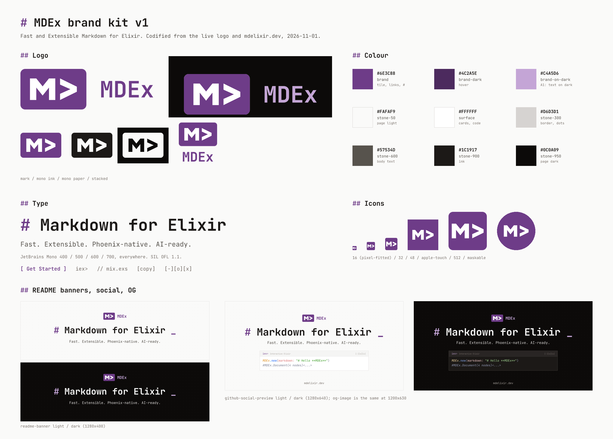
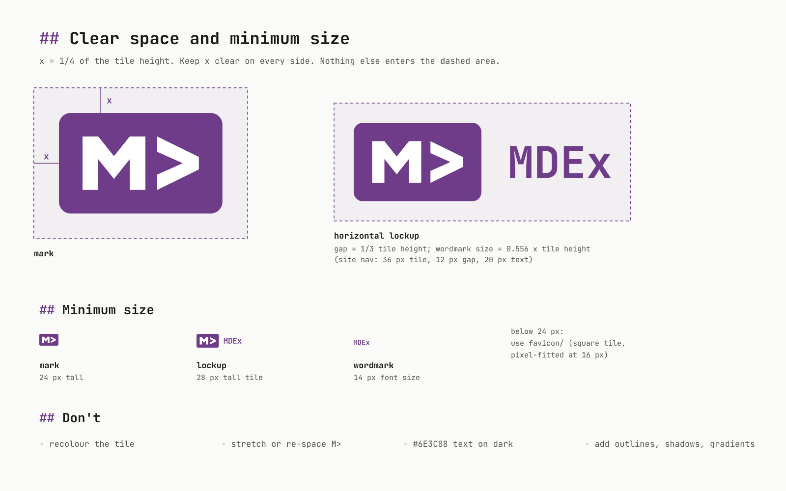

# MDEx brand

Fast and Extensible Markdown for Elixir.

This kit writes down the MDEx logo and the look of [mdelixir.dev](https://mdelixir.dev) as they ship today. Nothing here is a redesign. The few changes from what's live are marked **(A1)** to **(A4)**; see "Changes from what's live" at the end.



## Voice

- Talk like the docs and the site: short, plain, technical. "Fast. Extensible. Phoenix-native. AI-ready."
- Markdown is the brand. Headings get a purple `#` or `##`, buttons are `[ bracketed ]`, labels read like code (`// mix.exs`, `iex>`, `[copy]`).
- Show code, not adjectives. A real `MDEx.new(...)` line beats a claim.
- Lowercase for project names in running text, as on the site: "powered by comrak | ammonia | lumis".

Approved lines (all taken from the site or README):

| Use | Copy |
|---|---|
| Tagline | Fast and Extensible Markdown for Elixir |
| Hero | # Markdown for Elixir |
| Sub-line | Fast. Extensible. Phoenix-native. AI-ready. |
| Long description | Fast and Extensible Markdown for Elixir with native Phoenix LiveView HEEx integration. |
| Credit | Built with Elixir and Rust by Leandro Pereira |

## Colour

| Token | Hex | Use |
|---|---|---|
| `brand` | `#6E3C88` | logo tile, links, `#` accents, primary button |
| `brand-dark` | `#4C2A5E` | hover on brand (white on it: 11.67:1) |
| `brand-on-dark` **(A1)** | `#C4A5D6` | brand-coloured *text* on dark surfaces |
| `on-brand` | `#FFFFFF` | glyphs on the tile, button labels (7.88:1 on brand) |
| `stone-50` | `#FAFAF9` | page, light |
| `surface` | `#FFFFFF` / `#1C1917` | cards and code blocks, light / dark |
| `surface-muted` | `#F5F5F4` / `#292524` | code-block headers |
| `border` | `#D6D3D1` / `#57534E` | 1px borders (cards are dashed) |
| `border-hover` | `#A8A29E` / `#78716C` | |
| `text-primary` | `#1C1917` / `#F5F5F4` | |
| `text-secondary` | `#57534D` (stone-600) / `#A6A09B` (stone-400) | sub-lines, body |
| `stone-950` | `#0C0A09` | page, dark |
| `success` | `#009966` | copy-confirmation tick |
| selection | `#6E3C88` at 20% | text selection |

Neutrals are Tailwind v4's stone scale; the hex values above are the sRGB conversion of its oklch values. Code is highlighted by Lumis with Catppuccin Latte (light) and Catppuccin Macchiato (dark).

Contrast (WCAG 2): brand on stone-50 7.55:1, brand on white 7.88:1. Brand on stone-950 is only 2.51:1, which is why dark mode uses `#C4A5D6` (9.13:1) for brand-coloured text **(A1)**. The tile itself stays `#6E3C88` in both themes.

**Dot grid.** The hero and CTA sit on a 20px dot grid: one 1px-radius dot at (2,2) per tile, `#D6D3D1` at 50% (dark: `#44403C` at 50%), with the layer at 60% opacity in the hero and 40% in the CTA. It's in `tokens/tokens.css` as `.bg-dots`.

## Type

**JetBrains Mono**, everywhere: headings, body, UI, code. Weights 400, 500, 600 (buttons) and 700 (headings, wordmark).

- Licence: SIL Open Font License 1.1. Source: <https://github.com/JetBrains/JetBrainsMono> (licence text: `OFL.txt` in that repo). The site loads it from Bunny Fonts: `https://fonts.bunny.net/css?family=jetbrains-mono:400,500,600,700`.
- Stack: `"JetBrains Mono", ui-monospace, SFMono-Regular, "SF Mono", Menlo, Consolas, monospace`.
- Hero: 700, 4.5rem at desktop (2.25rem on phones), line-height 1.25. Section heads (`## ...`): 700, 1.875rem. Sub-line: 400, 1.5rem, text-secondary.
- All SVGs in this kit have the text converted to paths, so no font files are needed to use them.

## Logo

The mark is the **M>** tile: a white M and `>` on a `#6E3C88` rounded rectangle (208 x 128, corner radius 15). The wordmark is **MDEx** in JetBrains Mono Bold.

| Version | Use |
|---|---|
| `logo/mark.svg` | default; works on light and dark backgrounds |
| `logo/mark-mono-ink.svg` / `mark-mono-paper.svg` | one-colour, glyphs knocked out; ink on light, paper on dark |
| `logo/wordmark-light.svg` / `-dark.svg` | brand purple on light, `#C4A5D6` on dark **(A1)** |
| `logo/wordmark-mono-ink.svg` / `-mono-paper.svg` | one-colour |
| `logo/lockup-horizontal-*.svg` | mark + wordmark, as in the site nav |
| `logo/lockup-stacked-*.svg` | mark over wordmark, for square spaces |
| `png/*.png`, `png/*@2x.png` | raster copies of everything above |

**Horizontal lockup proportions** (from the site nav: 36px mark, 12px gap, 20px text): gap = 1/3 of the tile height; wordmark size = 0.556 x tile height; wordmark cap height centred on the tile.

**Clear space:** x = 1/4 of the tile height on every side. **Minimum size:** mark 24px tall; horizontal lockup 28px tile height; wordmark 14px font size. Below 24px use `favicon/`. See `rules/clear-space-min-size.png`.



### Do

- Use the files as they are. Pick `-dark` versions on dark backgrounds.
- Keep the UI square-cornered. The logo tile is the only rounded thing.
- Pair the logo with markdown-syntax UI: `#`, `##`, `[ ]`, `//`, blinking `_`.

### Don't

- Recolour the tile, or use a gradient, outline, glow or shadow on it.
- Stretch the mark, change the M> spacing, or redraw the glyphs.
- Set brand-purple `#6E3C88` text on a dark background (use `#C4A5D6`).
- Put the mark in another container (a circle, a second box). Use the square icons in `favicon/` when you need a square.
- Push the mark closer to the Markdown Mark (M + down arrow). The `>` is what makes it MDEx.

## Icons

| File | Size | Use |
|---|---|---|
| `favicon/favicon.svg` | vector | modern browsers **(A2)** |
| `favicon/favicon.ico` | 16, 32, 48 | legacy; the 16px frame is pixel-fitted |
| `favicon/favicon-16.png`, `-32.png`, `-48.png` | | |
| `favicon/apple-touch-icon.png` | 180, opaque | iOS home screen |
| `favicon/icon-192.png`, `icon-512.png` | | web manifest, `any` |
| `favicon/icon-maskable-192.png`, `-512.png` | | web manifest, `maskable` (glyphs inside the 80% safe circle) |
| `favicon/site.webmanifest`, `head-snippet.html` | | drop-in tags, incl. light/dark `theme-color` |

## Banners, social and OG

| File | Size | Use |
|---|---|---|
| `banners/readme-banner-light.svg/.png/@2x.png` | 1280 x 400 | README header, light |
| `banners/readme-banner-dark.svg/.png/@2x.png` | 1280 x 400 | README header, dark |
| `social/github-social-preview.png` (+ `-dark`, + `.svg` sources) | 1280 x 640 | GitHub, Settings -> Social preview |
| `og/og-image.png` (+ `-dark`, + `.svg` sources) | 1200 x 630 | `og:image` for mdelixir.dev and links **(A3)** |

All of them reuse the hero: dot grid, lockup, `# Markdown for Elixir _`, the sub-line and (social/OG) the `iex>` block.

## Motion

Everything below is read from the shipped CSS and JS on mdelixir.dev. Keyframes and timing tokens are in `tokens/tokens.css`.

**Principles.** Motion types things out, like a terminal. It runs once, it's quick, and it never blocks reading.

| What moves | How | Timing / easing |
|---|---|---|
| Hero title | typed one character at a time, after a 600ms delay | 40-80ms per character (random) |
| Hero cursor `_` | blinks in brand purple; hidden once typing ends | `blink 1s step-end infinite` (opacity 0 at 50%) |
| Hero sub-line | fades in 200ms after the title | `fade-in .5s ease-out` |
| Hero code block | slides up 500ms after the sub-line | `slide-up .6s ease-out` (opacity 0 -> 1, translateY 20px -> 0) |
| Hero buttons | slide up 1000ms later | `slide-up .6s ease-out` |
| "powered by" | fades in 400ms later | `fade-in .5s ease-out` |
| Scroll-down arrow | bounces | Tailwind `bounce 1s infinite` |
| Section reveals (`[data-animate]`) | slide up or fade in once, when 10% visible (bottom margin -50px) | `.6s` / `.5s ease-out` |
| Feature cards | slide up, staggered | +100ms per card |
| Card corner `+` | turns 90 degrees and goes brand purple on hover | `.3s ease-out` |
| Cards, borders | border to brand on hover | 300ms |
| Primary button | brand -> brand-dark, scale 1.05 on hover | 150ms `cubic-bezier(.4,0,.2,1)` |
| Benchmark bars | grow from 0 (scaleX) when 30% visible; numbers count up | 2500ms ease-out `cubic-bezier(0,0,.2,1)`; rows +200ms each; counters ease-out cubic `1-(1-t)^3` |
| Memory comparison | slides up after the bars | 800ms delay, `slide-up` |
| Streaming demo | markdown typed token by token, purple blinking `\|` cursor, loops | 40-300ms per token (+0-30ms jitter); 4s hold, 1s pause; starts 500ms after 30% visible |
| Testimonials | two rows scroll in opposite directions; pause on hover | `marquee 45s linear infinite` (35s at <= 640px) |
| Nav | gains background, blur and shadow after 50px of scroll | 300ms |
| Tabs | new panel fades in | `fade-in .5s` |
| Copy button | shows an emerald tick | 2s |
| Anchor links | smooth scroll | `scroll-behavior: smooth` |

**Reduced motion** (`prefers-reduced-motion: reduce`): CSS sets every animation and transition to .01ms with one iteration and turns smooth scrolling off. The JS shows the hero's final text at once and hides the cursor, leaves benchmark bars at their final width, skips scroll reveals (content is visible from the start), and shows the streaming demo's full text without typing. Keep this behaviour for anything new.

## Changes from what's live

| | Change | Files |
|---|---|---|
| A1 | Brand-coloured text on dark uses `#C4A5D6` instead of `#6E3C88` | `*-dark` wordmark and lockups, dark banners/social/OG, `tokens` |
| A2 | Square favicon and app icons (same tile, glyphs and colour); opaque apple-touch icon; maskable icons | `favicon/` |
| A3 | Opaque 1200 x 630 OG image based on the hero, replacing the transparent 1200 x 738 logo card | `og/` |
| A4 | `>` path snapped to clean, symmetric coordinates (max shift 0.5 of 208 units, not visible); `title`/`role` added | `logo/*.svg` |

## Suggested HTML

```html
<!-- light/dark logo -->
<picture>
  <source media="(prefers-color-scheme: dark)" srcset="assets/brand/logo/lockup-horizontal-dark.svg">
  
</picture>
```

Favicons: see `favicon/head-snippet.html`.
